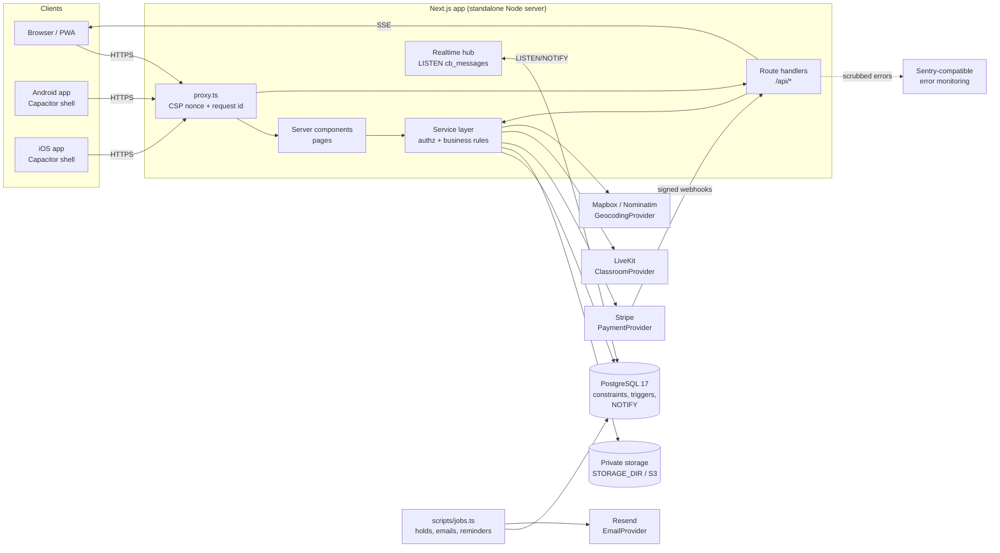
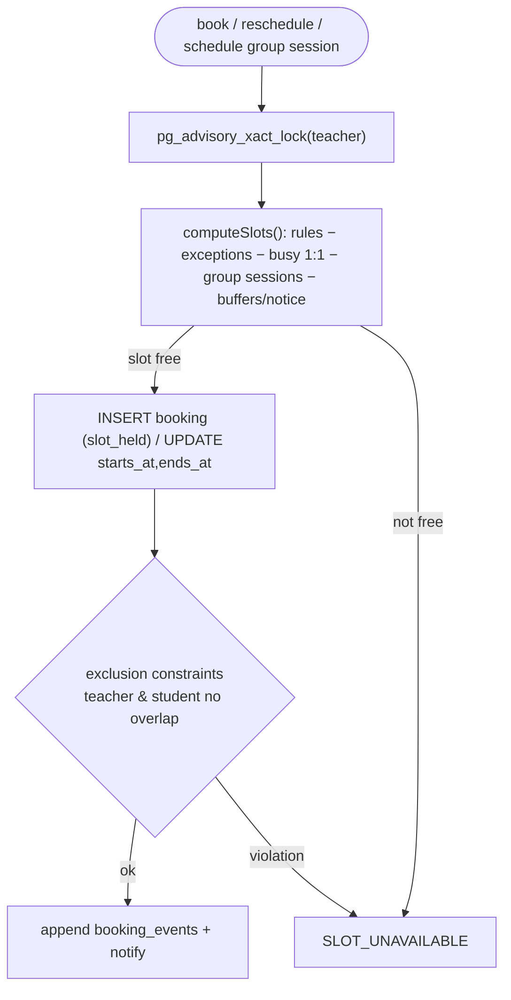
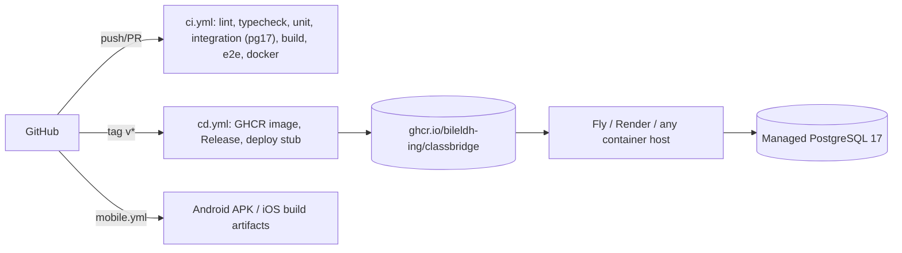

# Architecture

ClassBridge is a single Next.js 16 (App Router, React 19, TypeScript) application backed by PostgreSQL 17 through Drizzle ORM. Server components and route handlers call a framework-agnostic **service layer** (`src/lib/services/*`) that owns every business rule and authorization check; providers sit behind adapters that report an explicit "not configured" state instead of pretending to succeed.

## System context


## Request lifecycle & authorization
```mermaid
sequenceDiagram
  participant C as Client
  participant X as proxy.ts
  participant R as route() wrapper
  participant S as Service
  participant D as PostgreSQL
  C->>X: request
  X->>X: per-request nonce → CSP header, x-request-id
  X->>R: forward
  R->>R: same-origin check (mutations), Zod body parse
  R->>S: requireUser / requirePermission (+ staff TOTP check)
  S->>D: ownership checks, rate limit, transaction
  D-->>S: rows / constraint violations (mapped to AppError)
  S-->>R: result
  R-->>C: JSON or {error:{code,message}}; unexpected errors → captureException (PII-scrubbed)
```

## Booking & rescheduling concurrency

Group seats: the session row is locked `FOR UPDATE`, active seats are counted against capacity, a partial unique index blocks duplicate seats, and sessions have their own exclusion constraint.

## Realtime messaging
`messages` has an `AFTER INSERT` trigger calling `pg_notify('cb_messages', {c, m})`. Each app instance keeps one `LISTEN` connection (`src/lib/realtime.ts`) and fans out to SSE streams (`/api/conversations/[id]/stream`) that were opened only after a membership check. Events carry ids only; clients fetch content through the authorised API (30 s polling fallback).

## Security layers
| Layer | Mechanism | Code |
|---|---|---|
| Transport/headers | nonce CSP (`strict-dynamic`), HSTS (https), XFO DENY, COOP/CORP, Permissions-Policy | `src/proxy.ts`, `src/lib/security/csp.ts`, `next.config.ts` |
| AuthN | argon2id, hashed DB sessions, staff TOTP per session | `src/lib/auth/*`, `src/lib/services/mfa.ts` |
| AuthZ | role → permission matrix + ownership checks in services; admin pages `forbidden()` (HTTP 403) | `src/lib/auth/permissions.ts`, `src/app/(app)/admin/layout.tsx` |
| Abuse | Postgres fixed-window rate limits | `src/lib/services/rate-limit.ts` |
| Data | constraints, append-only triggers (audit, ledger, booking events, quiz attempts, grades) | `drizzle/*.sql` |
| Files | magic-byte sniffing, 5 MB cap, random keys, private dir, sandboxed downloads | `src/lib/storage.ts` |
| Observability | JSON logs with redaction, Sentry envelope adapter, `onRequestError` | `src/lib/log.ts`, `src/lib/monitoring.ts`, `src/instrumentation.ts` |

## Deployment topology


## Mobile
The PWA (`src/app/manifest.ts`, `public/sw.js`) is installable and shows an offline page. `capacitor.config.ts` wraps the **deployed URL** (`CAP_SERVER_URL`) in native shells (`android/`, `ios/`) so cookies, SSR and CSP behave exactly as on the web; store delivery runs through `fastlane/Fastfile` lanes gated on signing secrets.
