# Database

PostgreSQL 17, Drizzle ORM schema in `src/lib/db/schema.ts`, versioned SQL migrations in `/drizzle` (applied by `pnpm db:migrate`, tracked in `drizzle.__drizzle_migrations`; `/api/health/ready` reports pending migrations).

| Migration | Content |
|---|---|
| `0000_extensions` | pgcrypto, btree_gist, cube, earthdistance, pg_trgm (standard contrib — no PostGIS) |
| `0001_init` | all base tables, enums, FKs, checks, indexes |
| `0002_constraints` | booking exclusion constraints, append-only triggers, FTS/trigram/earthdistance indexes |
| `0003_production` | group sessions (+ exclusion constraint, rebuilt teacher constraint, seat uniqueness), reschedule counter, support threads, guardian links, assignments/submissions/grades (append-only), notes, bookmarks, announcements, message attachments + `cb_messages` NOTIFY trigger, staff TOTP columns, course moderation, default feature flags |

Conventions: UUID primary keys, `timestamptz` (UTC) + IANA zone columns, money as integer minor units + ISO-4217 currency, append-only history tables enforced by triggers (`cb_forbid_mutation`), no client-side DB access (authorization is in the service layer; see `SECURITY_PRIVACY.md`).

## Entity–relationship diagram

```mermaid
erDiagram
  users ||--|| profiles : has
  users ||--o{ user_roles : holds
  users ||--o{ sessions : "signs in"
  users ||--o{ auth_tokens : verifies
  users ||--o{ consent_records : gives
  users ||--o{ privacy_requests : files
  users ||--o| teacher_profiles : "may teach as"
  users ||--o{ guardian_links : "guardian of"
  users ||--o{ guardian_links : "learner in"

  subject_categories ||--o{ subjects : groups
  teacher_profiles ||--o{ teacher_subjects : teaches
  subjects ||--o{ teacher_subjects : ""
  teacher_profiles ||--o{ teacher_credentials : submits
  teacher_profiles ||--o{ teacher_badges : earns
  teacher_profiles ||--o| teacher_locations : "private + approximate"
  teacher_profiles ||--o{ lesson_offerings : offers
  teacher_profiles ||--o{ availability_rules : "weekly"
  teacher_profiles ||--o{ availability_exceptions : "blocked/extra"
  teacher_profiles ||--o{ group_sessions : schedules
  lesson_offerings ||--o{ group_sessions : "type=group"

  users ||--o{ bookings : "books (student)"
  teacher_profiles ||--o{ bookings : receives
  lesson_offerings ||--o{ bookings : for
  group_sessions ||--o{ bookings : "seats"
  bookings ||--o{ booking_events : "append-only history"
  bookings ||--o{ attendance_records : ""
  bookings ||--o{ lesson_notes : ""
  bookings ||--o{ classroom_events : ""
  bookings ||--o| reviews : "one per booking"

  users ||--o{ orders : buys
  orders ||--o{ order_items : ""
  order_items }o--o| bookings : ""
  orders ||--o{ payment_intents : ""
  payment_intents ||--o{ payment_events : "append-only"
  payment_intents ||--o{ refunds : ""
  teacher_profiles ||--o{ teacher_ledger_entries : "append-only"
  provider_webhook_events }o--|| orders : "idempotent processing"

  conversations ||--o{ conversation_members : ""
  conversations ||--o{ messages : ""
  messages ||--o{ message_attachments : "private files"
  users ||--o{ notifications : receives
  users ||--o{ email_outbox : "idempotent emails"
  users ||--o{ saved_teachers : saves
  users ||--o{ user_reports : reports
  users ||--o{ support_tickets : opens
  support_tickets ||--o{ support_ticket_messages : "public + internal"

  teacher_profiles ||--o{ courses : authors
  courses ||--o{ course_sections : ""
  course_sections ||--o{ course_lessons : ""
  course_lessons ||--o| quizzes : ""
  quizzes ||--o{ quiz_questions : ""
  quiz_questions ||--o{ question_options : ""
  quizzes ||--o{ quiz_attempts : "append-only"
  courses ||--o{ course_enrollments : ""
  users ||--o{ lesson_progress : ""
  courses ||--o{ certificates : issues
  courses ||--o{ assignments : ""
  assignments ||--o{ assignment_submissions : "written answers"
  assignment_submissions ||--o{ submission_grades : "append-only history"
  course_lessons ||--o{ course_notes : "private"
  course_lessons ||--o{ course_bookmarks : ""
  courses ||--o{ course_announcements : ""

  users ||--o{ audit_log : "actor (append-only)"
  feature_flags }o--o| users : "updated by"
```

## Key constraints
| Constraint | Purpose |
|---|---|
| `bookings_teacher_no_overlap` (GiST exclusion, `group_session_id IS NULL`) | a teacher can't hold two overlapping 1:1 bookings in an occupying state |
| `bookings_student_no_overlap` | a student can't hold overlapping active bookings (incl. group seats) |
| `group_sessions_teacher_no_overlap` | scheduled group sessions can't overlap each other |
| `booking_group_seat_uq` (partial unique) | one active seat per student per session |
| `guardian_open_link_uq` (partial unique on lower(email)) | one pending/active link per guardian–learner pair |
| `submission_assignment_user_uq` | one written answer per learner per assignment |
| append-only triggers | `booking_events`, `audit_log`, `payment_events`, `teacher_ledger_entries`, `quiz_attempts`, `submission_grades` (UPDATE) |
| `messages_notify` trigger | realtime fan-out on `cb_messages` |
| check constraints | prices ≥ 0, durations 15–240, capacity 1–50 (sessions 2–50), attachment size ≤ 5 MiB, message/answer lengths |

## Operations
- Backups: managed PostgreSQL PITR (daily snapshots + WAL); test restores quarterly (see `DEPLOYMENT.md`).
- Migrations are additive; deploys run `node migrate.mjs` (Docker image) before starting the new version.
- Dev/test reset uses `TRUNCATE` (bypasses row triggers by design); never run `pnpm db:seed` against production (the script refuses when `NODE_ENV=production`).
